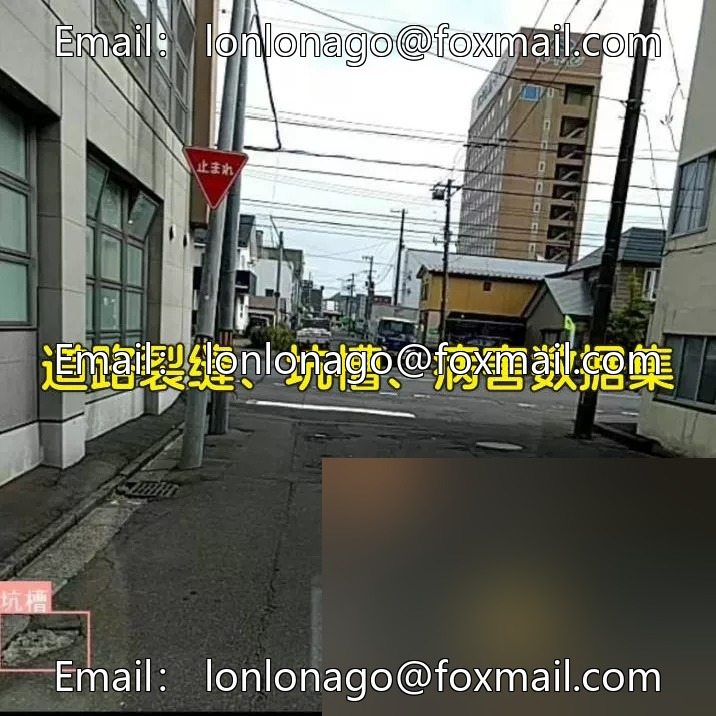
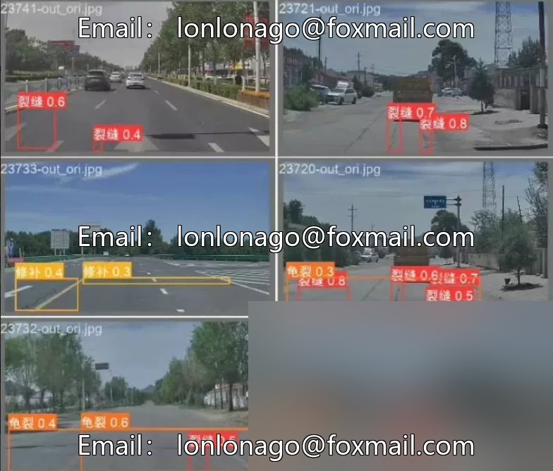

# Road cracks, pits, and disease datasets

## Body

Road cracks, pitting, and disease dataset
Contains labels for cracks, pits, cracks, and patching
Total of 3000 images
Cracks: include horizontal cracks and vertical cracks, 3218
Pitting 1079,
Cracks: include mesh cracks and cracks, 1439
Patching: include crack, pitting, and crack patching, 1511
A portion of the patch-related data uses data augmentation strategies; if you are dissatisfied, please leave

web-based shipment, can be directly photographed and shipped.

The dataset covers road cracks, potholes and diseases with labels including cracks, potholes, cracks and patching, totalling 3000 images; the images show main water, crack sizes and patching types.

<!-- AI_ENRICHED -->

## Images

## Payment

Here is a pay link on Stripe ( https://buy.stripe.com/3cs8yP7sY87d0vu9AB ). Please contact me lonlonago@foxmail.com after funding $89, and I will send you a complete data files , thank you!

